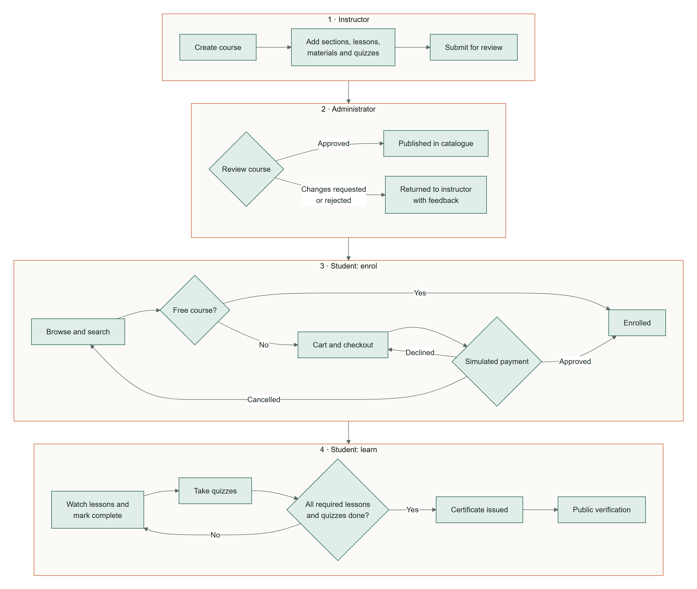

# eShikkha – Learning Management System

A course marketplace and learning platform built with Django for System Development Project, inspired by Udemy. Instructors publish and sell courses, students buy and complete them, and administrators moderate the platform.

## Workflow

<p align="center"></p>

## Database

See [docs/DATABASE.md](docs/DATABASE.md) for the ER diagram and an explanation of the relationships.

## Screenshots


<table>
<tr><td width="50%" valign="top"><br><sub>Course page</sub></td><td width="50%" valign="top"><br><sub>Simulated payment gateway</sub></td></tr>
<tr><td width="50%" valign="top"><br><sub>Course player</sub></td><td width="50%" valign="top"><br><sub>Timed quiz</sub></td></tr>
<tr><td width="50%" valign="top"><br><sub>Instructor: curriculum builder</sub></td><td width="50%" valign="top"><br><sub>Instructor: quiz builder</sub></td></tr>
<tr><td width="50%" valign="top"><br><sub>Admin: dashboard</sub></td><td width="50%" valign="top"><br><sub>Admin: course moderation</sub></td></tr>
</table>

## Quick start

Requirements: Python 3.12 or later

```bash
# 1. Create and activate a virtual environment (or use an existing conda env)
python -m venv .venv
.venv\Scripts\activate          # Windows
source .venv/bin/activate       # macOS / Linux

# 2. Install dependencies
pip install -r requirements.txt

# 3. Create the database
python manage.py migrate

# 4. (Recommended) Load demo data: users, 12 courses, purchases, progress, reviews
python manage.py seed_demo

# 5. Run
python manage.py runserver
```

Open http://127.0.0.1:8000.

| Demo account  | Username     | Password     | Lands on                      |
| ------------- | ------------ | ------------ | ----------------------------- |
| Student       | `student`    | `Demo@12345` | `/learn/`: learning dashboard |
| Instructor    | `instructor` | `Demo@12345` | `/teach/`: instructor studio  |
| Administrator | `admin`      | `Demo@12345` | `/manage/`: admin panel       |

You can log in with either the username or the email address (for example `student@eshikkha.local`). The admin account is also a Django superuser, so it can open the secondary `/django-admin/` back office.

To start again from an empty database, run `python manage.py flush`, then `python manage.py seed_demo`.

For a database without demo data, run `python manage.py createsuperuser`. Superusers automatically get the administrator role.

### Running the tests

```bash
python manage.py test
```

## Architecture

```
eShikkha/        project settings and root URLs
core/            platform settings, audit log, reports, announcements
accounts/        custom User role, profile, instructor applications
courses/         catalogue models, marketplace search (selectors.py)
learning/        enrolments, progress, course player, certificates, verification
assessments/     quizzes, attempts, server-side grading and attempt rules
commerce/        cart, orders, simulated payment gateway, instructor earnings
notifications/   in-app notifications
studio/          instructor workspace
adminpanel/      moderation-focused admin console
templates/       Django templates (base layout, partials, one folder per app)
static/          design-system CSS and JS file
```

## Feature walkthrough

### Student

- Search, filter and sort the course catalogue
- Course pages with curriculum, free previews and reviews
- Cart, checkout and a **sandbox payment** (approve, decline or cancel)
- Learning dashboard to resume courses and track progress
- Course player with video, materials and **Mark as complete**
- Timed quizzes with attempt limits and explanations
- PDF certificates with a QR code and public verification
- Reviews, reports, purchase history and profile settings

### Instructor (`/teach/`)

- Create courses with pricing, discounts and completion rules
- Build the curriculum: sections, lessons, videos and materials
- Build quizzes: multiple choice and true/false, pass mark, time limit
- Submit for review and get admin feedback
- Track student progress, quiz stats, reviews and earnings

### Administrator (`/manage/`)

- Dashboard with platform stats and review queues
- Approve, reject or request changes on courses
- Manage users, roles and enrolments
- Moderate reviews and handle reports
- View transactions and issue refunds
- Manage categories, tags, announcements and settings
- Analytics and an audit log
- No impersonation: accounts are inspected read-only

## Security and integrity rules

- **Prices are server-side.** Orders read prices from the database, and the browser only sends course IDs and an outcome keyword. A test checks that a posted `price=0.01` is ignored.
- **Payments are idempotent.** The order row is locked, an already-paid order returns its original transaction, and a database constraint allows only one successful transaction per order.
- **Access is checked server-side.** Lesson pages, video streams and resource downloads all check for an active enrolment, ownership or the admin role. Uploaded videos and resources are not publicly served from `/media/`.
- **Progress and certificates are derived on the server** from completion and attempt rows; there is no endpoint that accepts a progress value.
- **Quiz answers never reach the browser before they're allowed.** The quiz page contains no correctness data, and submitted option IDs are validated against each question.
- **Role-based access control** is applied to every view, and instructors can only load their own courses (other courses return 404).
- **Standard Django protections** are on: CSRF on every form, password validators, and safe redirects for `next` URLs. Suspended accounts are signed out on their next request.
