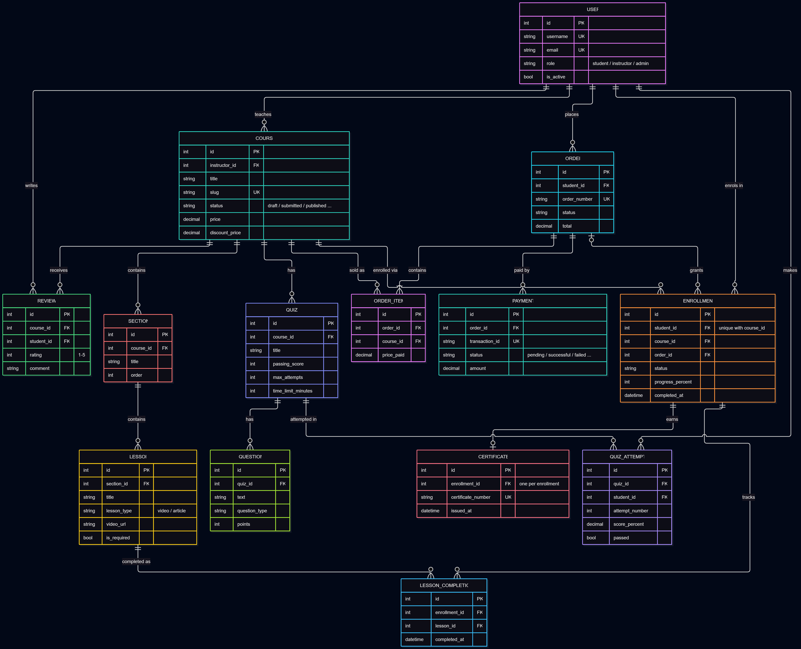

# eShikkha database design

A simplified view of the eShikkha database: the 14 core tables behind courses, learning, quizzes and purchases.

## ER diagram

## Tables

| Table                 | Stores                                                                                                                                              |
| --------------------- | --------------------------------------------------------------------------------------------------------------------------------------------------- |
| **User**              | Every account. `role` is student, instructor or admin; `is_active = false` means suspended.                                                         |
| **Course**            | A course created by an instructor, with its price, discount and status (draft → submitted → published, or changes requested / rejected / archived). |
| **Section**           | An ordered group of lessons within a course.                                                                                                        |
| **Lesson**            | A video or article lesson. `is_required` decides whether it counts towards completion.                                                              |
| **Quiz**              | A course quiz with its pass mark, time limit and attempt limit.                                                                                     |
| **Question**          | A multiple-choice or true/false question in a quiz.                                                                                                 |
| **Quiz Attempt**      | One student's attempt at a quiz: attempt number, score and whether it passed.                                                                       |
| **Enrollment**        | A student's access to a course, with progress and completion date.                                                                                  |
| **Lesson Completion** | One row per lesson a student has finished.                                                                                                          |
| **Certificate**       | Issued when an enrollment is completed. Has a unique public number used for verification.                                                           |
| **Review**            | A student's 1–5 star rating and comment on a course.                                                                                                |
| **Order**             | A purchase by a student, with a unique order number, status and total.                                                                              |
| **Order Item**        | One course in an order, with the price paid at the time of purchase.                                                                                |
| **Payment**           | A (simulated) payment attempt for an order: pending, successful, failed, cancelled or refunded.                                                     |

## Relationships

**Users and courses.** A user with the instructor role teaches many courses; each course has exactly one instructor. Students interact with courses through enrollments, orders, quiz attempts and reviews.

**Course structure.** A course contains sections, a section contains lessons, and a course has quizzes with questions. Deleting a course removes its sections, lessons and quizzes with it.

**Enrollment (student ↔ course).** Enrollment is the link between a student and a course and is the only thing that grants access to paid lessons.

- Each student can be enrolled in a course at most once (`UNIQUE(student, course)`).
- An enrollment is created by a successful order, by enrolling in a free course, or by an admin granting access.
- A refund marks the enrollment as refunded instead of deleting it, so the history is kept.

**Progress.** Each finished lesson adds a Lesson Completion row (a lesson can only be completed once per enrollment). Progress is calculated on the server:

> progress = (required lessons completed + required quizzes passed) ÷ (required lessons + required quizzes)

For example, a course with 10 required lessons and 8 completed shows 80%.

**Quizzes.** A quiz has many questions and many attempts. Each attempt belongs to one student and one quiz. Attempt numbers are unique per student and quiz, which lets the server enforce the attempt limit.

**Certificates.** An enrollment earns at most one certificate (one-to-one), and only after the server confirms all required lessons and quizzes are done.

**Orders and payments.** An order belongs to one student and contains one or more order items, each pointing to a course. An order can have several payment attempts (for example, a declined payment followed by a successful one), but only one can succeed. When it does, the order grants an enrollment for each course in it.

**Reviews.** A student can leave one review per course (`UNIQUE(course, student)`), and only after enrolling and making some progress.
